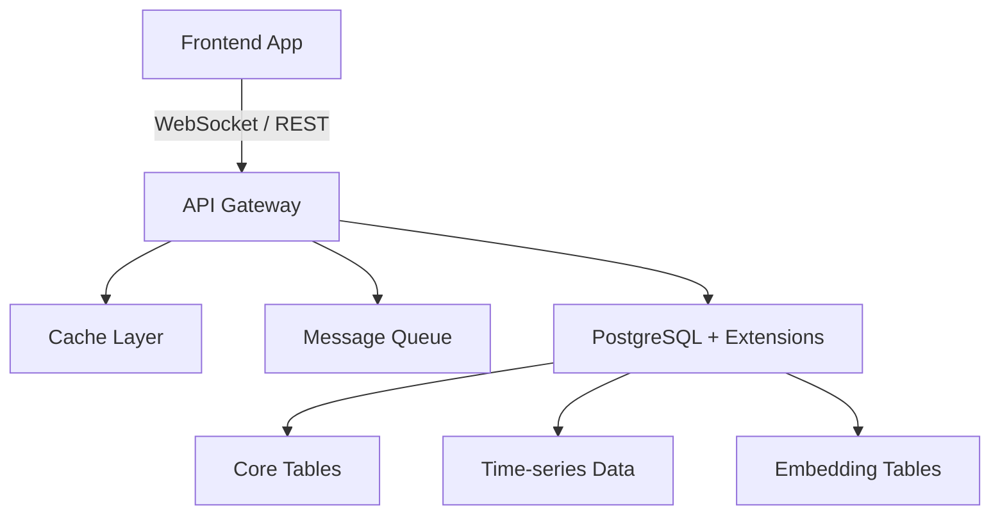

# Markdown

## Overview

Keep every markdown file the agent creates, edits, or reviews within the project's conventions. The formatter (prettier, markdownlint-cli2) fixes most formatting; the rules below are the ones it cannot fix, so they hold while writing.

## Additional Resources

- For a complete document in the preferred style, see [example.md](references/example.md): read it before creating a new markdown file

## Core Principles

- The formatter settles spacing, blank lines around headings, table alignment and trailing whitespace. In a project without one, write them that way: a blank line after every heading, table pipes aligned
- Every rule under Skill-Specific Guidelines, and any other lint rule the formatter cannot fix, holds in the file as written

## Skill-Specific Guidelines

### Number headings without parentheses

A numbered heading uses a number and a period, or no number at all.

```md
<!-- Bad -->

### 1) Section Name

<!-- Good -->

### Section Name

### 1. Section Name
```

### Use emojis only when they carry information

**Valid uses:**

- Check and cross marks for pros/cons or allowed/disallowed in tables or short lists
- Warning symbols for important warnings or notices
- Color circles or squares to indicate criticality levels (green/yellow/orange/red)

**Invalid uses:**

- Number emojis in place of plain numbers: write `1.`, `2.`, `3.`
- Emojis in headings: headings are plain text unless there is an exceptional reason
- Decorative emojis on every section
- A check mark on every item of a list: a plain list says the same

```text
<!-- Bad: a decorative emoji and a number emoji in headings, counts written as headings -->

# [rocket emoji] Mono-Repo Structure

### [keycap-1 emoji] Apps Are Deployable Units

### 1 root package.json

### 1 package.json per app
```

```md
<!-- Good -->

# Mono-Repo Structure

### 1. Apps Are Deployable Units

- 1 root package.json
- 1 package.json per app
```

### Draw diagrams with arrows or Mermaid

Documentation is consumed by LLMs, and ASCII box diagrams with box-drawing characters are hard to parse and maintain.

- For simple flows, use arrow notation on separate lines
- For real diagrams that need structure, use Mermaid code blocks

````md
<!-- Good: simple multi-line flow -->

Frontend Application
-> (WebSocket / REST)
-> API Gateway
-> Cache Layer
-> Message Queue
-> PostgreSQL + Extensions
-> Core Tables (Operational)
-> Time-series Data
-> Embedding Tables

<!-- Good: Mermaid for complex diagrams -->


````

### Separate sections with headings, not horizontal rules

Headings already provide visual and semantic separation. Reserve `---` for a deliberate break: frontmatter, a distinct shift in context within a section, or appendix content.

```md
<!-- Bad: --- between every section -->

## Installation

Install the package.

---

## Configuration

Configure the settings.

<!-- Good: headings are sufficient -->

## Installation

Install the package.

## Configuration

Configure the settings.
```

### Indent content inside list items

Content that belongs to a list item (code blocks, paragraphs, nested lists) is indented to align with the item text. Unindented content breaks the list, and the next item restarts its numbering (MD029).

````md
<!-- Bad: code block breaks the list, second item restarts at 1 -->

1. First item

```text
Code block
```

1. Second item

<!-- Good: code block is indented, list continues -->

1. First item

   ```text
   Code block
   ```

2. Second item
````

### Specify language on code blocks (MD040)

Every fenced code block has a language identifier, for syntax highlighting and for tools that parse the content.

````md
<!-- Bad -->

```
sudo apt install curl
```

<!-- Good -->

```bash
sudo apt install curl
```
````

### Use headings, not bold text, for sections (MD036)

A section title is a heading, which provides semantic structure and navigation; bold text on its own line is not.

```md
<!-- Bad: bold text acting as a heading -->

**Tier 1 (Must Have)**

- Coinbase
- Kraken

<!-- Good: proper heading -->

## Tier 1 (Must Have)

- Coinbase
- Kraken
```

### Document structure

- Start with a top-level heading (`# Title`)
- Use hierarchical headings (`##`, `###`, `####`) for sections
- Separate sections with a single blank line
- Use a table only for a true grid: several attributes compared across many rows. In skill and agent files, prefer a `**Key**: effect` list (see esp-create-skill)
- Place references and links at the end of the document

## Instructions

1. **Creating a file**: read [example.md](references/example.md), then write the file following the document structure and every rule above.
2. **Editing a file**: read the file first, then apply the changes, preserving its existing style and every rule above.
3. **Reviewing a file**: run the formatter on the file first (step 4), then check the file against every rule above and fix or flag each violation.
4. **Format**: after creating or editing, run the project's formatter on the file (e.g., `pnpm exec prettier --write <file>`). Done when the formatter has run and no rule above is violated in the file.

## Output Guidance

When the skill is invoked directly, output a human-readable summary:

- Status (reviewed, created, or edited)
- File path
- List of non-auto-fixable issues found, if any
